<p align="center">
  
</p>

## About

I'm a **beginner** teaching myself systems programming and reverse engineering on **Windows and Linux**. I learn best by building things, so most of my projects are small tools that help me see what happens between source code and a running program: how compilers lay out objects and metadata, how linkers put a binary together, how loaders map it into memory, and how debuggers and unwinders read it back.

Something I've found fascinating so far is the metadata a compiler *has* to leave in a binary, such as RTTI, vtables, unwind tables and import tables. It survives stripping, and it can tell you a surprising amount about how a program is put together.

<p align="center">
  
</p>

### What I'm learning

- **Windows x64 internals:** PE/COFF layout, the MSVC C++ ABI, RTTI and class hierarchies, vtables, imports and exports
- **Linux internals:** ELF, the System V AMD64 ABI, DWARF call frame information and `.eh_frame`, program headers and the dynamic loader
- **Reverse engineering:** reading stripped binaries with Ghidra, GDB, x64dbg and WinDbg, and writing small tools to help along the way
- **Languages:** C++ for my Windows tools, Rust for cross-platform command-line tools, C for the low-level parts, and Python for scripts and tests

### How I'm learning

- **By building:** I learn each file format by writing a tool that reads it, and test it on binaries I've built myself
- **By checking my work:** I compare my results with established tools like `readelf` and `llvm-readobj`, so I find out when I've got something wrong
- **By keeping it small:** each tool does one thing and has no third-party dependencies, so I can understand every line
- **By writing it down:** each README explains the format the tool reads, which helps me check that I really understand it

## Toolbox

The languages and tools I've been learning with so far:

<table>
  <tr>
    <td><b>Languages</b></td>
    <td>
      
      
      
      
    </td>
  </tr>
  <tr>
    <td><b>Platforms</b></td>
    <td>
      
      
    </td>
  </tr>
  <tr>
    <td><b>Build</b></td>
    <td>CMake &nbsp;·&nbsp; Cargo &nbsp;·&nbsp; MSVC &nbsp;·&nbsp; MinGW-w64 &nbsp;·&nbsp; GCC &nbsp;·&nbsp; Clang / LLD</td>
  </tr>
  <tr>
    <td><b>Analysis</b></td>
    <td>Ghidra &nbsp;·&nbsp; x64dbg &nbsp;·&nbsp; WinDbg &nbsp;·&nbsp; GDB &nbsp;·&nbsp; readelf / objdump</td>
  </tr>
  <tr>
    <td><b>Formats &amp; ABIs</b></td>
    <td>PE/COFF &nbsp;·&nbsp; ELF &nbsp;·&nbsp; DWARF CFI &nbsp;·&nbsp; MSVC C++ ABI &nbsp;·&nbsp; System V AMD64 &nbsp;·&nbsp; Microsoft x64 calling convention</td>
  </tr>
</table>

## Projects

These are my learning projects: two small toolkits for taking binaries apart, one for each binary format. The PE tools are C++17 with CMake and build on Windows, Linux and macOS; the ELF tool is Rust. They're all MIT-licensed, tested in CI, and have no third-party dependencies.

<table>
  <tr>
    <td colspan="2" valign="top">

### [unwind-map](https://github.com/sheratonc/unwind-map)

My biggest project so far. It works out where functions start and end in **stripped** Linux ELF binaries by reading the `.eh_frame` unwind tables, which `strip` can't remove. It also works when the section headers are gone, flags functions with exception handling, points out code that has no unwind info, can put symbols back with `objcopy`, exports to Ghidra and JSON, and draws the binary as a Hilbert-curve map. I checked it against `llvm-readobj`'s decoder on x86-64, x86 and AArch64 test binaries, and it found every function with unwind info without any false starts.

<p align="center">
  
  
</p>

<sub><code>Linux</code> &nbsp;<code>Rust</code> &nbsp;<code>ELF</code> &nbsp;<code>DWARF CFI</code> &nbsp;<code>x86-64 · x86 · AArch64</code> &nbsp;<code>CI-tested</code></sub>

</td>
  </tr>
  <tr>
    <td width="50%" valign="top">

### [pe-walker](https://github.com/sheratonc/pe-walker)

A command-line inspector I wrote to learn the Portable Executable format. It prints the DOS and NT headers, section layout, imports and exports.

```powershell
pe-walker --summary app.exe
```

<sub><code>Windows</code> &nbsp;<code>C++17</code> &nbsp;<code>PE/COFF</code> &nbsp;<code>x86 / x64</code></sub>

</td>
    <td width="50%" valign="top">

### [pe-diff](https://github.com/sheratonc/pe-diff)

Compares two PE files: headers, sections, imports and exports. It exits non-zero when something changed, so it can be used in a CI pipeline.

```powershell
pe-diff -T old.dll new.dll
```

<sub><code>Windows</code> &nbsp;<code>C++17</code> &nbsp;<code>PE/COFF</code> &nbsp;<code>patch diffing</code></sub>

</td>
  </tr>
  <tr>
    <td width="50%" valign="top">

### [rtti-dump](https://github.com/sheratonc/rtti-dump)

Rebuilds class hierarchies from stripped MSVC x64 binaries by following the RTTI structures: Complete Object Locator → Class Hierarchy Descriptor → Base Class Array.

```powershell
rtti-dump --demangle app.exe
```

<sub><code>Windows</code> &nbsp;<code>C++17</code> &nbsp;<code>MSVC RTTI</code> &nbsp;<code>class recovery</code></sub>

</td>
    <td width="50%" valign="top">

### [vtable-dump](https://github.com/sheratonc/vtable-dump)

A companion to rtti-dump. It finds each class's vtable through its Complete Object Locator back-reference and lists the virtual function slots.

```powershell
vtable-dump -f exception app.exe
```

<sub><code>Windows</code> &nbsp;<code>C++17</code> &nbsp;<code>MSVC ABI</code> &nbsp;<code>vtables</code></sub>

</td>
  </tr>
  <tr>
    <td colspan="2" valign="top">

### [pattern-scan](https://github.com/sheratonc/pattern-scan)

A single-header C++17 library for IDA-style byte signature scanning. It uses `memchr` to find candidates before doing the full compare, which made it about 11× faster than a byte-by-byte scan in my benchmark, and a randomized test checks every result against a simple reference scanner.

```cpp
const auto sig = patscan::parse("48 8B ?? E8 ?? ?? ?? ?? 85 C0");
const auto* hit = patscan::find(data, size, sig);
```

<sub><code>cross-platform</code> &nbsp;<code>C++17</code> &nbsp;<code>header-only</code> &nbsp;<code>signature scanning</code></sub>

</td>
  </tr>
</table>

<br>

<p align="center">
  <sub>I'm still a beginner, so if you spot something wrong or have tips, please open an issue. Every tool here is built and tested against my own test binaries.</sub>
</p>
